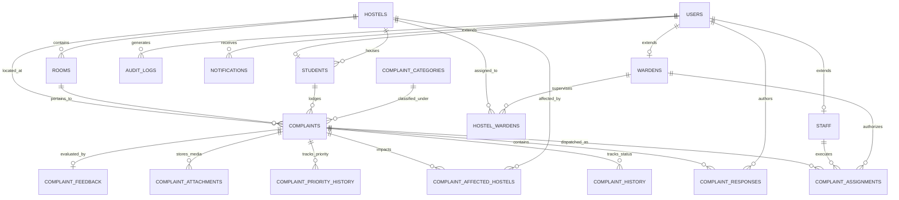

# 🏢 Hostel Complaint Management System (HCMS)

> A centralized, production-grade, secure, and fully responsive campus facility operations and complaint lifecycle management platform. Engineered with **Python 3**, **Flask**, **MySQL 8.0+ (InnoDB Engine)**, and **Vanilla JavaScript / CSS3**.

---

## 📌 1. Project Overview & Objective

The **Hostel Complaint Management System (HCMS)** replaces traditional, inefficient manual paper registers with an automated, auditable, and transparent digital workflow. In university residential campuses, maintenance delays, lost complaint slips, lack of student visibility, and unmonitored staff turnarounds lead to frustration and degraded facility standards. 

HCMS solves this by providing:
- **Real-Time Ticket Lifecycle Tracking**: From initial lodging to technician assignment, work verification, student feedback, and closing.
- **Strict Role-Based Multi-Tenancy**: Dedicated workspaces for **Students**, **Wardens**, **Maintenance Technicians**, and **Administrators**.
- **Tenant & Block Isolation**: Wardens only manage complaints in their assigned hostel blocks; students can only inspect their own records.
- **Advanced Concurrency Control**: Optimistic locking (`version_id`) and MySQL row locks (`FOR UPDATE`) to prevent race conditions during concurrent triage.
- **Auditable Service Level Agreements (SLA)**: Automated calculation of resolution deadlines per category with risk escalation for overdue tickets.
- **Duplicate Ticket Detection**: Intelligent lexical-token analysis preventing students from filing duplicate tickets for active hostel issues.

---

## 🏛️ 2. Architectural Design

HCMS adheres to a clean, decoupled **Layered MVC / Service-Repository Architecture**:

```
                  ┌──────────────────────────────────────────────┐
                  │          Web Browser / Client                │
                  │  (HTML5, Responsive Glassmorphic CSS3, JS)   │
                  └──────────────────────┬───────────────────────┘
                                         │ HTTP / HTTPS (REST & Forms)
                                         ▼
                  ┌──────────────────────────────────────────────┐
                  │            Presentation Layer                │
                  │  (Flask Blueprints: auth, student, warden,   │
                  │        staff, admin, notifications)          │
                  └──────────────────────┬───────────────────────┘
                                         │ Business Delegation
                                         ▼
                  ┌──────────────────────────────────────────────┐
                  │              Service Layer                   │
                  │   - ComplaintService                         │
                  │   - AssignmentService                        │
                  │   - AdminService                             │
                  │   - NotificationService                      │
                  └──────────────────────┬───────────────────────┘
                                         │ Direct Parameterized SQL
                                         ▼
                  ┌──────────────────────────────────────────────┐
                  │      Data Access & Connection Pooling        │
                  │   (mysql.connector.pooling.MySQLConnection)  │
                  └──────────────────────┬───────────────────────┘
                                         │ TCP Socket / Port 3306
                                         ▼
                  ┌──────────────────────────────────────────────┐
                  │             MySQL 8.0+ Database              │
                  │  18 Tables, Triggers, Stored Procedures,     │
                  │   Views, Composite Indexes, Audit Logs       │
                  └──────────────────────────────────────────────┘
```

### Key Architectural Tenets:
1. **Zero ORM Overhead**: Implements direct, parameterized SQL queries via `mysql-connector-python` to maximize performance, leverage native database features (triggers, procedures, window functions), and eliminate SQL injection risks.
2. **Connection Pooling**: Uses `MySQLConnectionPool` to reuse database worker threads efficiently under concurrent campus loads.
3. **Optimistic Concurrency Control**: Every transactional update verifies the row `version_id`. If another user altered the ticket simultaneously, the transaction rolls back cleanly with a concurrency warning.

---

## 👥 3. User Roles & Permission Matrix

| Role | Scope & Permissions | Key Workflows |
| :--- | :--- | :--- |
| **Student** | Personal Room & Hostel Block | Register, log in, submit tickets (private or general), attach photo evidence, track live progress, view warden updates, rate resolved tickets (1-5 stars), cancel pending tickets, view alerts. |
| **Warden** | Assigned Hostel Blocks Only | Filter complaints by category/priority/status, assign tasks to technicians, update priorities with mandatory audit reasons, add management notes, verify completion, close tickets, view block SLA reports. |
| **Maintenance Staff** | Assigned Work Orders Only | View dispatched work orders, update task state (`in_progress`, `completed`), submit work notes, upload completion photo proof, review historical jobs. |
| **Administrator** | University-Wide System Governance | Comprehensive executive dashboard, manage user accounts (students, wardens, staff), activate/deactivate accounts, configure hostel blocks & rooms, manage categories & SLAs, review security audit logs, export CSV datasets. |

---

## 🔄 4. Complaint Lifecycle State Machine

A ticket strictly follows defined state transitions. Arbitrary jumps are prohibited by backend validation and database constraints:

```
               [Student Lodges Complaint]
                           │
                           ▼
                     ┌───────────┐
         ┌──────────►│ Submitted │◄──────────┐
         │           └─────┬─────┘           │
         │ (Reopen)        │                 │ (Cancel if unassigned)
         │                 ▼                 ▼
         │          ┌──────────────┐   ┌───────────┐
         │          │ Under Review │   │ Cancelled │
         │          └──────┬───────┘   └───────────┘
         │                 │ (Warden assigns staff)
         │                 ▼
         │          ┌──────────────┐
         │          │   Assigned   │
         │          └──────┬───────┘
         │                 │ (Staff accepts / starts)
         │                 ▼
         │          ┌──────────────┐
         │          │ In Progress  │
         │          └──────┬───────┘
         │                 │ (Staff completes work & uploads proof)
         │                 ▼
         │     ┌────────────────────────┐
         │     │  Awaiting Verification │
         │     └───────────┬────────────┘
         │                 │ (Warden inspects & approves)
         │                 ▼
         │          ┌──────────────┐
         └──────────┤   Resolved   │
                    └──────┬───────┘
                           │ (Student submits 1-5★ Rating)
                           ▼
                    [Ticket Closed]
```

---

## 🗄️ 5. Database Schema & Normalization Analysis

The database consists of **18 relational tables** designed to prevent data redundancy and modification anomalies.

### Entity-Relationship Diagram (Mermaid)



---

### Database Normalization Proof (1NF to BCNF)

| Normal Form | Compliance Criteria | How the Schema Satisfies It |
| :--- | :--- | :--- |
| **1NF (First Normal Form)** | Atomic column values, unique row identifiers, no repeating attribute groups. | Every column stores atomic scalar values (no comma-separated lists). Multi-hostel general complaints use a dedicated bridge table `complaint_affected_hostels`. Every table defines a single primary key. |
| **2NF (Second Normal Form)** | In 1NF, and no non-prime attribute is functionally dependent on a subset of any candidate key (no partial dependencies). | In tables with composite candidate keys (e.g. `hostel_wardens` on `(hostel_id, warden_id)`), non-prime attributes like `assigned_date` depend on the whole key. Tables with single-column primary keys automatically satisfy 2NF. |
| **3NF (Third Normal Form)** | In 2NF, and no non-prime attribute depends transitively on the primary key ($X \to Y \to Z$). | Student attributes (e.g., student name, phone) are not duplicated in `complaints`. Instead, `complaints` stores only `student_id`, which references `students`, which in turn references `users`. Category SLA hours belong to `complaint_categories`, eliminating transitive dependencies. |
| **BCNF (Boyce-Codd Normal Form)** | For every non-trivial functional dependency $X \to Y$, $X$ must be a superkey. | All functional dependencies have candidate keys as determinants. Room uniqueness is enforced by the composite candidate key `(hostel_id, room_number)`. Staff employee codes and emails are enforced by unique superkeys (`uq_users_email`, `uq_staff_emp_code`). |

---

### Detailed Table Specifications

1. `users`: Master identity records with bcrypt password hashes, phone check constraints, and role enum (`student`, `warden`, `staff`, `admin`).
2. `hostels`: Campus blocks (`name`, `code`, `type`, `total_floors`).
3. `rooms`: Residential rooms per block with capacity and occupancy checks (`chk_rooms_occupancy`).
4. `students`: Student profiles with unique enrollment number, assigned hostel, and room.
5. `wardens`: Warden profiles with unique employee codes and campus office locations.
6. `staff`: Technicians with trade specializations (`plumbing`, `electrical`, `carpentry`, etc.) and availability status.
7. `hostel_wardens`: M:N associative mapping of wardens to overseen hostel blocks.
8. `complaint_categories`: Master classifications with default SLA turnaround hours (e.g., Plumbing: 24h, Internet: 12h) and default priority.
9. `complaints`: Transactional complaint records with ticket numbers (`CMP-YYYY-XXXX`), `version_id` for optimistic concurrency, `sla_deadline`, `priority`, `visibility`, and `status`.
10. `complaint_affected_hostels`: M:N bridge mapping general campus complaints affecting multiple hostel blocks.
11. `complaint_assignments`: Dispatched work orders linking a complaint to a technician and supervising warden.
12. `complaint_responses`: Official timeline dialogue between students, wardens, and staff.
13. `complaint_history`: Immutable state transition audit trail populated automatically by triggers.
14. `complaint_priority_history`: Mandatory justification log whenever a warden alters a ticket priority.
15. `complaint_attachments`: Secure media registry for initial evidence and technician completion photos.
16. `notifications`: Real-time user alert inbox.
17. `complaint_feedback`: Post-resolution 1-to-5 star student satisfaction ratings and remarks.
18. `audit_logs`: Enterprise security trail capturing actors, IP addresses, target entities, and JSON snapshots.

---

## ⚡ 6. Advanced MySQL DBMS Capabilities

This codebase showcases enterprise-level relational database programming:

### 1. Database Triggers (`database/triggers.sql`)
- `trg_complaint_status_audit`: Automatically inserts an audit record into `complaint_history` whenever `complaints.status` changes.
- `trg_prevent_invalid_cancellation`: Throws SQLSTATE `45000` if a student attempts to cancel a complaint that is already assigned or in progress.
- `trg_student_occupancy_increment` & `decrement`: Automatically updates `rooms.current_occupancy` upon student profile creation or deletion.

### 2. ACID Stored Procedures (`database/procedures.sql`)
- `sp_assign_staff_to_complaint`: Executes atomic technician dispatch using `FOR UPDATE` row locks, verifies optimistic locking version (`version_id`), updates ticket state to `Assigned`, and rolls back on concurrency collision.
- `sp_resolve_complaint`: Atomically verifies work order completion, logs warden verification notes, records resolution timestamp, and dispatches student notifications.
- `sp_reopen_complaint`: Validates that reopen attempts do not exceed 5, restores ticket to `Reopened`, recalculates SLA, and updates version counters.
- `sp_scan_and_escalate_overdue`: Scans active tickets where `NOW() > sla_deadline`, flags `is_overdue = 1`, escalates priority to `Critical`, and alerts wardens.

### 3. Database Views (`database/views.sql`)
- `vw_complaint_full_details`: Denormalized reporting view joining students, hostel blocks, categories, assignments, technicians, and feedback.
- `vw_warden_dashboard_summary`: Multi-hostel rollup computing submitted, assigned, in-progress, resolved, critical, and overdue metrics per block.
- `vw_staff_task_queue`: Technician operational view consolidating active tickets and work locations.

### 4. Advanced Analytical Queries (`database/reports.sql`)
- **Common Table Expressions (CTEs) & Window Functions**: Computes technician performance and ranks staff turnaround efficiency using `DENSE_RANK() OVER (ORDER BY tasks_completed DESC)`.
- **Top-N per Group**: Extracts the top 3 most recent tickets per hostel block using `ROW_NUMBER() OVER (PARTITION BY c.hostel_id ORDER BY c.created_at DESC)`.
- **Correlated Subqueries & HAVING**: Identifies students reporting significantly higher complaints than their block peer average.
- **NOT EXISTS**: Pinpoints idle technicians with zero active tickets available for dispatch.
- **Self-Joins**: Detects recurring hardware issues in the exact same room occurring within a 7-day window.
- **CASE Expressions**: Classifies active tickets into dynamic SLA health risk tiers (`Normal`, `Moderate <24h`, `High Risk <6h`, `Breached`).

---

## 🔒 7. Cybersecurity & Defensive Hardening

1. **Cryptographic Password Security**: Uses Werkzeug's PBKDF2 with SHA-256 password hashing. Raw passwords are never stored.
2. **SQL Injection Elimination**: 100% of database interactions execute via direct parameterized statements (`%s` placeholders). No dynamic string concatenation is used in queries.
3. **Cross-Site Request Forgery (CSRF)**: All state-changing POST forms and asynchronous APIs require cryptographic CSRF tokens stored in secure session state.
4. **Secure File Upload Pipeline**:
   - Filenames are sanitized via `werkzeug.utils.secure_filename`.
   - Extensions strictly validated against a whitelist (`.png`, `.jpg`, `.jpeg`, `.webp`, `.pdf`).
   - File size enforced at 5 MB max on both frontend and backend (`MAX_CONTENT_LENGTH`).
   - Stored outside the web root in structured subdirectories (`uploads/evidence`, `uploads/completion`).
5. **Session Hardening**: Configured with `HttpOnly=True`, `SameSite='Lax'`, and an 8-hour expiration window.
6. **Defense-in-Depth Authorization**: Every controller endpoint validates user authentication (`@login_required`) and role permission (`@role_required`) on the server.

---

## 🛠️ 8. Local Setup & Installation Guide (Windows / VS Code)

### Prerequisites
- **Python 3.10+** (tested and verified with Python 3.15)
- **MySQL Server 8.0+** running locally on port 3306
- **MySQL Workbench** (optional, recommended for schema visualization)
- **Git**

---

### Step 1: Clone or Navigate to the Workspace
Open PowerShell in the project directory:
```powershell
cd c:\Users\gg621\OneDrive\Desktop\gemini
```

### Step 2: Create and Activate Virtual Environment
```powershell
python -m venv venv
.\venv\Scripts\Activate.ps1
```
*(If PowerShell restricts script execution, run: `Set-ExecutionPolicy -Scope Process -ExecutionPolicy Bypass`)*

### Step 3: Install Required Dependencies
```powershell
python -m pip install --upgrade pip
python -m pip install -r requirements.txt
```

### Step 4: Configure Environment Variables
Verify or update `.env` with your local MySQL password:
```ini
# Database Configuration
DB_HOST=localhost
DB_PORT=3306
DB_USER=root
DB_PASSWORD=your_mysql_root_password
DB_NAME=hostel_complaint_db

# Flask Security
SECRET_KEY=hcms_super_secure_secret_production_key_2026_xyz!
FLASK_ENV=development
FLASK_DEBUG=1
UPLOAD_FOLDER=uploads
MAX_CONTENT_LENGTH=5242880
```

### Step 5: Initialize and Seed MySQL Database
Run the automated schema and seed runner:
```powershell
python init_db.py
```
This executes:
1. `database/schema.sql` (Creates database and all 18 tables)
2. `database/triggers.sql` (Installs all automated audit triggers)
3. `database/procedures.sql` (Compiles stored procedures)
4. `database/views.sql` (Builds database reporting views)
5. `database/seed.sql` (Seeds demo campus blocks, rooms, users, categories, and tickets)

### Step 6: Start the Flask Application
```powershell
python app.py
```
Open your browser and navigate to:
```
http://127.0.0.1:5000
```

---

## 🔑 9. Demo Accounts & Credentials

All seeded demo accounts are configured with the default password: **`password123`**

| Role | Demo Email Address | Details & Access Scope |
| :--- | :--- | :--- |
| **Administrator** | `admin@hostel.edu` | Full administrative control across all hostels, users, categories, and audit logs. |
| **Warden (Hostel 1 & 2)** | `warden.sharma@hostel.edu` | Assigned to Boys Hostel 1 (BH-1) and Boys Hostel 2 (BH-2). |
| **Warden (Hostel 3)** | `warden.patel@hostel.edu` | Assigned to Girls Hostel 1 (GH-1). |
| **Maintenance Staff** | `staff.ramesh@hostel.edu` | Specialized in **Plumbing**. Dispatched to pipe and water issues. |
| **Maintenance Staff** | `staff.suresh@hostel.edu` | Specialized in **Electrical**. Dispatched to wiring, lights, and appliances. |
| **Maintenance Staff** | `staff.anita@hostel.edu` | Specialized in **Cleanliness & Sanitation**. |
| **Student** | `student.rahul@hostel.edu` | Resident in Boys Hostel 1 (BH-1), Room 101. |
| **Student** | `student.priya@hostel.edu` | Resident in Girls Hostel 1 (GH-1), Room 101. |

> **Quick Sign-In**: The login screen features one-click demo credentials buttons for instant evaluation.

---

## 🧪 10. Test Suite Execution

A complete unit and integration test suite is included in `tests/`:

```powershell
python -m unittest discover tests -v
```

### Coverage Highlights:
- `test_auth.py`: Password hashing, session creation, unauthenticated redirects, role enforcement.
- `test_complaints.py`: Form validation, short text rejection, duplicate token extraction.
- `test_warden.py`: Multi-tenant hostel scoping, unauthorized hostel access prevention.
- `test_staff.py`: Task queue access, completion notes, unauthorized admin barrier.
- `test_admin.py`: KPI retrieval, user status toggling, self-deactivation safeguards.
- `test_permissions.py`: Full RBAC boundary verification across all endpoints and cross-student isolation.
- `test_database.py`: Optimistic concurrency check, reopen limits, transaction rollback, and file extension whitelisting.

---

## 📂 11. Complete Project Structure

```
hostel_complaint_system/
│
├── app.py                      # Application factory, error handlers, and route registration
├── config.py                   # Environment configuration loader and constants
├── db.py                       # MySQL connection pool manager and context managers
├── init_db.py                  # DDL, triggers, views, and seed execution runner
├── requirements.txt            # Python dependencies (Flask, mysql-connector-python, etc.)
├── .env.example                # Template configuration file
├── .env                        # Local environment configuration
├── README.md                   # Comprehensive technical documentation
│
├── database/
│   ├── schema.sql              # 18 Normalized tables with BCNF compliance and indexes
│   ├── triggers.sql            # Automated status auditing and rule enforcement triggers
│   ├── procedures.sql          # ACID stored procedures for atomic dispatch and closing
│   ├── views.sql               # Denormalized views for dashboards and reporting
│   ├── seed.sql                # Production-grade seed data for hostels, rooms, and users
│   └── reports.sql             # Advanced SQL queries (CTEs, Window Functions, Self-Joins)
│
├── routes/
│   ├── auth.py                 # Login, student registration, and logout controllers
│   ├── student.py              # Student dashboard, lodge ticket, duplicate check, detail
│   ├── warden.py               # Warden triage, staff assignment, SLA reports, CSV export
│   ├── staff.py                # Technician task queue, work notes, proof upload
│   ├── admin.py                # Executive dashboard, user management, hostel management, CSV export
│   └── notifications.py        # Notification inbox and real-time polling endpoint
│
├── services/
│   ├── complaint_service.py    # Complaint lifecycle, duplicate detection, SLA deadlines
│   ├── assignment_service.py   # Technician allocation and workload balancing
│   ├── admin_service.py        # System KPIs, audit logs, and category governance
│   └── notification_service.py # Push alerts for ticket lifecycle events
│
├── utils/
│   ├── decorators.py           # @login_required, @role_required, and audit logger
│   ├── security.py             # Password hashing, CSRF tokens, file upload sanitization
│   └── validators.py           # Form input validation and business rule checks
│
├── static/
│   ├── css/
│   │   └── style.css           # Premium dark navy glassmorphic design system
│   └── js/
│       └── main.js             # Vanilla JS: alert auto-dismiss, file size checks, counters
│
├── templates/
│   ├── base.html               # Shared layout, navbar, footer, real-time alert poller
│   ├── notifications.html      # Central notification list
│   ├── auth/
│   │   ├── login.html          # Authentication view with demo accounts buttons
│   │   └── register.html       # Student self-registration with dynamic room population
│   ├── student/
│   │   ├── dashboard.html      # Personal student KPI counters and recent history
│   │   ├── submit.html         # Ticket lodge form with debounced duplicate warning
│   │   ├── complaints_list.html# Searchable, filterable complaints table
│   │   └── detail.html         # Status timeline, warden responses, rating modal
│   ├── warden/
│   │   ├── dashboard.html      # Assigned hostel counters, critical queue, workload
│   │   ├── complaints.html     # Filterable triage table with priority markers
│   │   ├── detail.html         # Assignment modal, priority editor with audit reason
│   │   └── reports.html        # Block SLA turnaround rates and rating stats
│   ├── staff/
│   │   ├── dashboard.html      # Assigned work order queue and status toggles
│   │   ├── task_detail.html    # Progress updater, completion note & image upload
│   │   └── history.html        # Completed work history
│   ├── admin/
│   │   ├── dashboard.html      # Executive KPIs, category charts, staff rank (DENSE_RANK)
│   │   ├── users.html          # User account table and activation toggles
│   │   ├── hostels.html        # Hostel blocks and warden assignment
│   │   ├── rooms.html          # Room allocation and occupancy inspector
│   │   ├── categories.html     # Category SLA hours and default priority configuration
│   │   ├── all_complaints.html # University-wide complaint registry and CSV export
│   │   └── audit_logs.html     # Security and administrative audit trail
│   └── errors/
│       ├── 403.html            # Forbidden error page
│       ├── 404.html            # Not found error page
│       └── 500.html            # Internal server error page
│
├── uploads/
│   ├── evidence/               # Storage for student complaint photo evidence
│   └── completion/             # Storage for technician work completion proof
│
└── tests/
    ├── test_auth.py            # Authentication and session tests
    ├── test_complaints.py      # Complaint validation and lifecycle tests
    ├── test_warden.py          # Warden multi-tenant isolation tests
    ├── test_staff.py           # Technician workflow tests
    ├── test_admin.py           # Administrative governance tests
    ├── test_permissions.py     # Role-based access control tests
    └── test_database.py        # Database concurrency, transaction, and upload tests
```

---

## ❓ 12. Troubleshooting & FAQ

### Issue: `1045 (28000): Access denied for user 'root'@'localhost'`
- **Solution**: Open `.env` and set `DB_PASSWORD` to your local MySQL root password. Then re-run `python init_db.py`.

### Issue: `Can't connect to MySQL server on 'localhost' (10061)`
- **Solution**: The MySQL Windows service is stopped. Open PowerShell as Administrator and run:
  ```powershell
  Start-Service MySQL80
  ```
  *(Or start the MySQL service via Windows Services `services.msc`).*

### Issue: `CSRF token validation failed`
- **Solution**: Ensure your browser accepts cookies (`HttpOnly` session cookie). If testing via Postman/cURL, include the CSRF token in the `csrf_token` form field or request header.

### Issue: `Selected file exceeds the maximum allowed upload limit`
- **Solution**: Uploaded images or documents must be under 5 MB. Allowed formats are `.png`, `.jpg`, `.jpeg`, `.webp`, and `.pdf`.

---

## 📜 License
Developed for educational excellence, college capstone evaluations, and technical project demonstrations in Computer Science & Engineering (CSE / DBMS).

